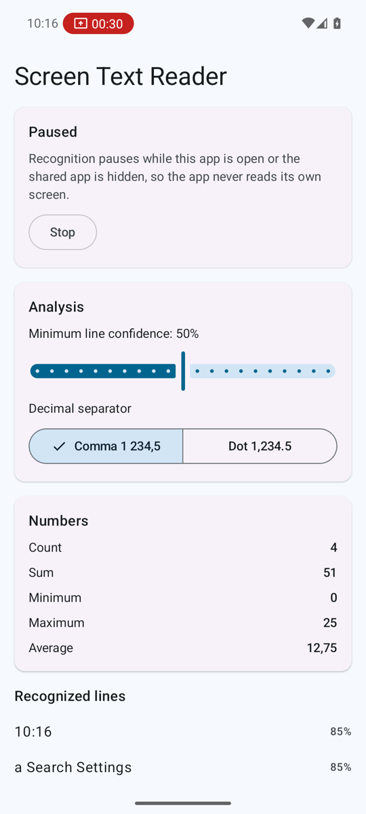
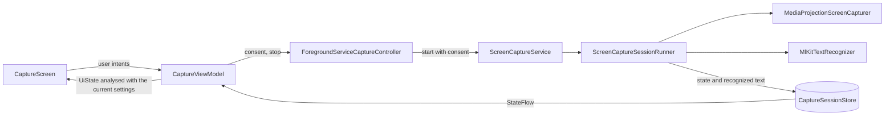

# Screen Text Reader

A small Android app that reads text from the screen in real time. It captures the screen with the MediaProjection API. inside a foreground service, recognizes text on new frames with ML Kit, and turns the result into a short numeric analysis that the user can tune with two parameters.

The project is a compact example of how I structure a native Android app in Kotlin: clear ownership of state, platform APIs kept behind small seams, and the logic that matters covered by tests.



The screenshot comes from an Android 16 emulator: capture was started for the entire screen, the Settings app stayed in front for twenty seconds, and the app was opened again, which paused recognition and showed the result.

## What the app does

- Asks for screen capture consent for every session, as Android 14 requires, and runs the capture in a `mediaProjection` foreground service with a Stop action in the notification.
- Reads the newest frame once per second, recognizes Latin text on the device (the ML Kit model is bundled, so it works offline) and publishes it only when the text has changed.
- Pauses recognition while the app itself is in front, so it never reads its own results, and while the shared app window is hidden (single-app sharing on Android 14 and newer). A frame that is already being recognized when the pause starts is still published, because it was captured from the other app.
- Analyses every frame with two parameters:
  - **confidence threshold**: lines the recognizer is less sure about are left out and counted,
  - **decimal separator**: decides whether `1.234` means one thousand two hundred thirty-four or a bit more than one.
- Shows the accepted lines and the count, sum, minimum, maximum and average of the numbers found in them. Changing a parameter re-analyses the text already recognized, without waiting for the next frame.

## Architecture

Single `:app` module, packaged by feature.

```
core/
  coroutines/      dispatcher qualifier and module
  designsystem/    Material 3 theme and spacing tokens
  lifecycle/       AppVisibility: is any screen of the app visible
  model/           RecognizedText, the contract between capture and analysis
feature/
  analysis/domain/ AnalysisSettings, NumberParser, TextAnalyzer, NumberStatistics
  capture/
    domain/        CaptureState, CaptureSession, ScreenCaptureController, ScreenTextReader.scan()
    data/          CaptureSessionStore, ScreenCaptureSessionRunner, MediaProjectionScreenCapturer,
                   ImageConversion, MlKitTextRecognizer, ProjectionCallback
    service/       ScreenCaptureService, ForegroundServiceCaptureController, CaptureNotifications
    ui/            CaptureRoute, CaptureScreen, CaptureViewModel, components
```



- **One owner per piece of state.** `CaptureSessionStore` is the single source of truth for the session. The service writes to it, the UI only reads it through the `CaptureSession` interface.
- **The service owns the projection.** `ScreenCaptureService` enters the foreground right after it is started, obtains the projection and hands it to `ScreenCaptureSessionRunner`, which suspends until the projection ends and always releases the virtual display, the image reader, the recognizer and the projection itself.
- **Frames are pulled, not pushed.** The scan loop asks for the latest frame only when the previous one has been recognized. `ImageReader.acquireLatestImage()` drops stale frames, so a slow recognizer never builds up a queue.
- **Platform code stays at the edges.** MediaProjection, `ImageReader` and ML Kit live in the data layer. The scan loop is a pure extension on the `ScreenTextReader` interface, and number parsing and statistics are plain Kotlin, so all of them are tested on the JVM.
- **UI split into route and content.** `CaptureRoute` wires the ViewModel and the activity result launchers. `CaptureScreen` takes immutable state and callbacks and is previewed and tested on its own.
- **Analysis parameters survive process death.** They live in `SavedStateHandle`.

## Screen capture details handled

- Consent is requested before every session, and a consent result is used for exactly one projection.
- The `MediaProjection.Callback` is registered before the virtual display is created, which Android 14 enforces.
- `onCapturedContentResize` resizes the virtual display and swaps the `ImageReader`, so rotation and single-app sharing keep full resolution.
- `onStop` ends the session when the user taps the status bar chip or locks the device.
- Row padding that some devices add to `RGBA_8888` image planes is handled when frames are copied into bitmaps.
- `CancellationException` is rethrown from every broad catch, so stopping the service is never reported as an error.

## Number parsing rules

`NumberParser` reads grouped (`1 234,56`, `1.234,56`, `1,234.56`) and plain numbers, negative numbers written with a hyphen or a minus sign, and non-breaking spaces used as grouping. A token glued to letters (`A4`, `X200`) is not a number. A number written with the other decimal separator (`12.5` while the comma is selected) is skipped rather than read as two different numbers.

## Tech stack

Kotlin 2.4, Android Gradle Plugin 9.4 with built-in Kotlin, Jetpack Compose with Material 3, Hilt with KSP, coroutines and Flow, ML Kit Text Recognition v2, AndroidX Lifecycle and Window. Tests use JUnit 4, kotlinx-coroutines-test, Turbine and Robolectric. All versions are in `gradle/libs.versions.toml`.

Minimum SDK 29 (Android 10, the first version with the `mediaProjection` foreground service type), target and compile SDK 37.

## Quality gates

Every change passes these checks, locally and in the GitHub Actions workflow:

```
./gradlew spotlessCheck        # ktlint, Android Studio code style
./gradlew lint                 # Android Lint, warnings are errors
./gradlew testDebugUnitTest    # unit tests and Robolectric Compose tests
./gradlew assembleDebug
```

The Kotlin compiler runs with `allWarningsAsErrors`. Lint checks that depend on the release date of new libraries (for example a newer dependency version) are reported but do not fail the build.

## Tests

- `NumberParserTest`, `TextAnalyzerTest`: parsing rules, confidence threshold, statistics and rounding.
- `ScreenTextScanningTest`: reading on every interval, skipping frames without changes, pausing and resuming, finishing a read that was in progress when the pause started, deduplication of unchanged text. Runs on virtual time.
- `CaptureSessionStoreTest`: session state transitions, including a failure that survives the stop.
- `CaptureViewModelTest`: UI state produced from the session and the settings, re-analysis after a parameter change, settings restored from `SavedStateHandle`, intents forwarded to the controller.
- `CaptureScreenTest`: Compose UI behaviour of the stateless screen on Robolectric.

The MediaProjection and ML Kit glue needs a real device and is verified manually.

## Running the app

Open the project in Android Studio or run `./gradlew installDebug` with a device connected. Tap **Start capture**, accept the system dialog, then switch to the app whose text you want to read and come back to see the result. Recognition pauses while Screen Text Reader is open.

## Possible next steps

- A floating overlay, so results are visible while the other app is in front.
- Instrumented tests of the capture pipeline on a Firebase Test Lab device matrix.
- Reusing bitmap buffers between frames if profiling shows allocation pressure at shorter intervals.
